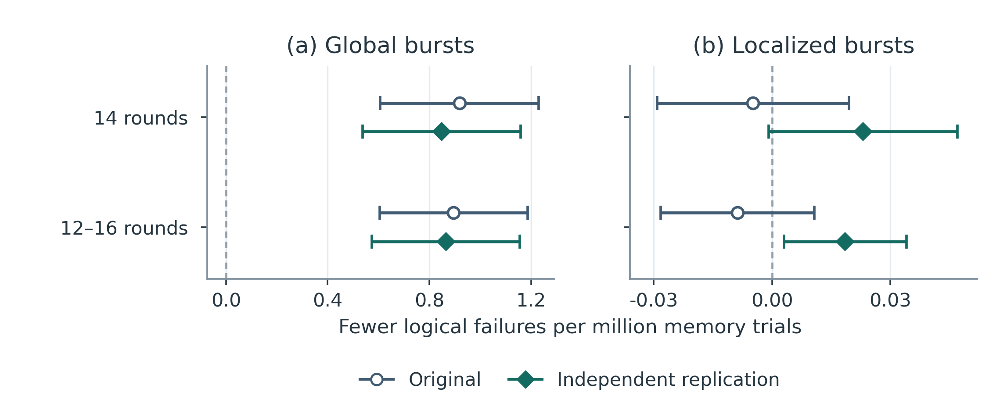

# Selective Waiting for Delayed Burst Alerts in Surface-Code Quantum Error Correction

Reproducibility package for the study by Mohammad Javani, Clark Atlanta University.

This study tests a decoder that uses the syndrome record to decide whether to wait three extra rounds for a burst alert. Its primary comparison holds the extra wait and syndrome data fixed and measures the additional effect of admitting late alert evidence.

| 84-round memory experiment | Fewer logical failures per million trials | Paired 95% interval |
| --- | ---: | ---: |
| Distance 7, global burst, fixed delay | 0.571 | 0.278 to 0.865 |
| Distance 9, global burst, variable delay | 0.896 | 0.604 to 1.187 |
| Distance 9, global burst, variable delay, independent replication | 0.865 | 0.574 to 1.155 |
| Distance 9, localized burst, variable delay | −0.009 | −0.028 to 0.011 |
| Distance 9, localized burst, variable delay, independent replication | 0.019 | 0.003 to 0.034 |

Population estimates assume a **0.1% probability of a burst per memory trial**. In the distance-9 trigger diagnostic, the rule opened the relevant extension for 99.82% of catchable global-burst alerts and 2.28% of catchable localized-burst alerts under variable delay. The localized and global models apply the same elevated error rate at 369 and 2,181 circuit locations, respectively.



## Verify the archive and regenerate the figures

Run these commands from the repository root on macOS, Linux, or WSL. The versioned simulation dependencies are listed in [requirements.txt](requirements.txt). The original runs record Python 3.12.14, and the independent replication records Python 3.14.6.

```bash
python3 -m venv .venv
.venv/bin/python -m pip install -r requirements.txt
.venv/bin/python scripts/verify_package.py
.venv/bin/python scripts/build_figures.py
```

If Python 3.14 is installed as `python3.14`, use `python3.14 -m venv .venv` in the first line. For a standard-library-only integrity check, run `python3 scripts/verify_package.py --hash-only`.

Verification checks the frozen files against [SHA256SUMS](SHA256SUMS), runs the experiment unit tests, and recomputes the archived estimates from the paired moments. The figure script writes the three manuscript figures to `reproduced/figures/`. Use the [reproduction guide](docs/REPRODUCE.md) for the paper-scale simulation commands and documentation of the result files.

## Experiment archives

| Experiment | Experiment source | Archived run | Root seed |
| --- | --- | --- | ---: |
| Distance 7, single commit | [v0.6.0](experiments/single_commit) | [Results](experiments/single_commit/results) | 2026111310 |
| Distance 7, rolling wait | [v0.7.0](experiments/rolling_wait) | [Results](experiments/rolling_wait/results) | 2026111311 |
| Distance 7, matched wait | [v0.8.0](experiments/matched_wait) | [Results](experiments/matched_wait/results) | 2026111312 |
| Distance 9, robustness | [v0.9.0](experiments/distance9) | [Results](experiments/distance9/results) | 2026111313 |
| Distance 9, independent replication | [v0.9.0](experiments/distance9) | [Results](experiments/distance9/replication) | 2026111410 |

The archive includes circuit-level logical X memory simulations, run manifests, and aggregate paired moments. The sensor generates a report with 90% probability at the true onset and independently generates a false alert with probability 0.0001 at each other candidate timestamp. Reported delays are in syndrome rounds.

## Citation

Use [CITATION.cff](CITATION.cff) to cite this software package. Its version is **1.0.0**. The table above gives the source experiment version for every data set.
